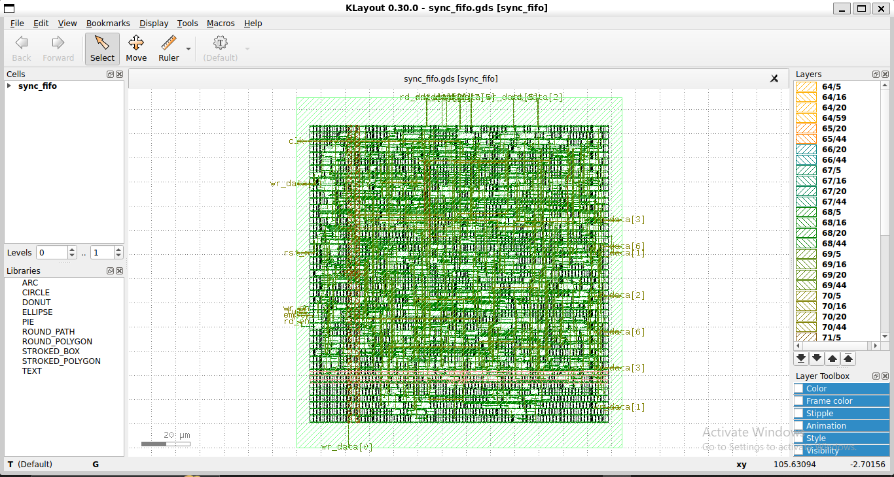

# 8-Tap Fixed-Point FIR Filter - RTL-to-GDSII on Sky130

A pipelined 8-tap FIR filter in Q1.15 fixed-point, verified against a NumPy golden reference model, then implemented through the full open-source ASIC flow on Sky130 at 100 MHz.

## Results
- Standard cells: 8,081
- Cell area: 68,239 um2 (die 165,266 um2)
- Setup slack at slow corner (max_ss_100C_1v60): **+4.03 ns** - no violations
- Hold, DRC, LVS, Antenna: clean

## Design notes
The first version implemented the 8-multiplier MAC in a single cycle and **failed setup timing at 100 MHz** (WNS -0.88 ns at the slow corner). Analysis showed the 16x16 multiply-and-accumulate array was the critical path. I split it into two pipeline stages - register the products, then accumulate - which closed timing with +4.03 ns slack for a ~5% cell area increase.

## Verification
The Python script generates Q1.15 coefficients and 50 random test vectors, computes the golden reference, and writes the vectors. The SystemVerilog testbench drives the RTL and compares bit-exactly against the model.

## Layout

## Related
- FIFO RTL-to-GDSII: github.com/DasAditya23/sync-fifo-sky130
- FIFO Verification: github.com/DasAditya23/fifo-uvm-verification
